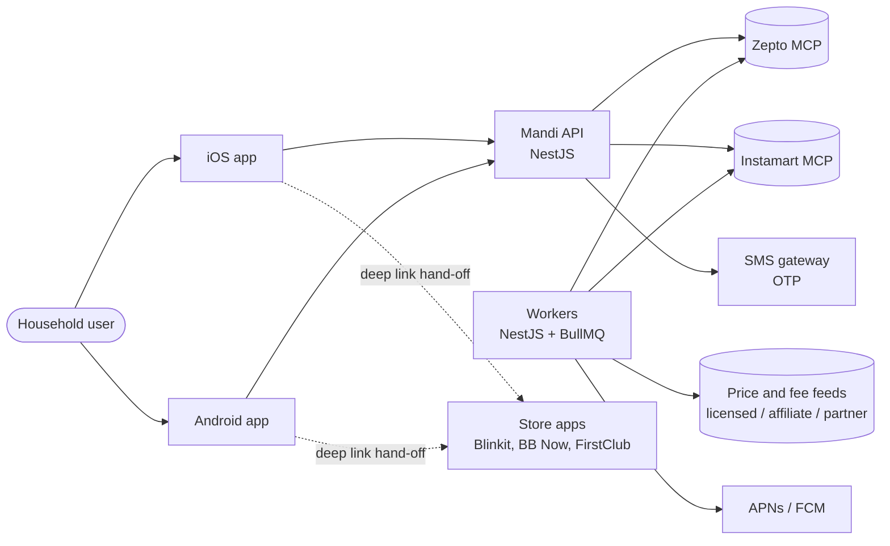

# Mandi — High-Level Design

Status: draft v1 · Owner: product + engineering · Region: AWS `ap-south-1` (Mumbai)

Mandi is two native apps (iOS, Android) talking to one NestJS API on AWS. Behind the API, a basket optimiser prices a household's usual items across stores and a checkout router either places the order through the store's official API (Zepto, later Instamart) or hands the user off to the store's app with a checklist. Everything runs on open-source software; AWS provides managed hosting for the open-source engines (PostgreSQL, Valkey, Kubernetes).

## 1. Context



Mandi never collects payment. Tier A orders are charged by the store to the user's own payment method; tier C orders are paid inside the store's app.

## 2. Components

| Component | Responsibility | Technology |
| --- | --- | --- |
| iOS app | All user flows; Live Activity checklist for hand-off | Swift 6, SwiftUI, swift-openapi-generator, Keychain |
| Android app | All user flows; notification bubble checklist for hand-off | Kotlin 2, Compose, Hilt, Retrofit (generated), Room, WorkManager |
| API (`services/api`) | Auth, users, addresses, store links, usuals, catalogue search, basket plans, checkout, orders, health, notifications | NestJS 11 (Fastify adapter), Drizzle ORM, request validation generated from OpenAPI |
| Workers (`services/workers`) | Price and fee ingestion, product matching, due-date scheduler, order-status polling, push sends | NestJS standalone + BullMQ |
| Store connector layer | One adapter per store behind a common interface: `search`, `price`, `buildCart`, `placeOrder`, `orderStatus`, `deepLink` | `@modelcontextprotocol/sdk` client for MCP stores; HTTP adapters for feeds |
| Basket optimiser | Cheapest / fewest-taps / single-store plans with all fees | TypeScript module, exact enumeration over store subsets |
| Health scorer | Grade A–E per product from nutrition data and user goals | TypeScript module, rules versioned in the database |
| Database | System of record | PostgreSQL 16 (Amazon RDS) with PostGIS, pg_trgm, pgvector, pg_partman |
| Cache and queues | Sessions, rate limits, price cache, BullMQ queues | Valkey 8 (Amazon ElastiCache for Valkey) |
| Object storage | Raw feed snapshots, product images cache, exports | Amazon S3 |
| Platform | Containers, ingress, GitOps, autoscaling | Amazon EKS, Envoy Gateway (Gateway API), Argo CD, Karpenter, External Secrets Operator |
| Observability | Traces, metrics, logs, dashboards, alerts | OpenTelemetry, Prometheus, Loki, Tempo, Grafana |
| Feature flags and analytics | Gradual rollout, experiments, product analytics | Unleash (self-hosted), PostHog |
| Infrastructure as code | All AWS resources | OpenTofu |

## 3. Checkout tiers

| Tier | Stores at launch | Mechanism | Taps |
| --- | --- | --- | --- |
| A — direct order | Zepto; Instamart after approval | Store MCP: build cart, place order with the user's OAuth token | 2 |
| B — cart fill (P1) | Same as A | Store MCP: build cart only; user pays in store app | 2 + pay in app |
| C — guided hand-off | Blinkit, BB Now, FirstClub | Deep link per product or search; iOS Live Activity / Android bubble checklist | 1 per store + adds |

The router picks a tier per store from the store's capability record and the user's link status; a store losing API access falls back to tier C without an app release.

## 4. Key flows

### 4.1 Link Zepto (OAuth + OTP)

```mermaid
sequenceDiagram
  participant App
  participant API
  participant Zepto as Zepto MCP (OAuth)
  App->>API: POST /v1/store-links/zepto/start
  API-->>App: authorize URL (PKCE, state)
  App->>Zepto: open in ASWebAuthenticationSession / Custom Tab
  Zepto-->>App: redirect https://api.mandi.app/oauth/zepto/callback?code
  App->>API: callback completes on server
  API->>Zepto: exchange code for tokens
  API->>API: encrypt tokens with KMS data key, store link
  API-->>App: link active; import order history job queued
```

The callback URL must be allowlisted by Zepto on a public production domain before launch (task MND-020).

### 4.2 Plan and check out a basket

```mermaid
sequenceDiagram
  participant App
  participant API
  participant Opt as Optimiser
  participant Z as Zepto MCP
  App->>API: POST /v1/baskets/{id}/plans
  API->>Opt: items, live offers per store, fee rules, user rules
  Opt-->>API: cheapest, fewest-taps, single-store plans
  App->>API: POST /v1/baskets/{id}/checkout (planId)
  API->>Z: re-check prices and stock
  alt changed more than ₹5 or out of stock
    API-->>App: 409 with changes for review
  else unchanged
    API->>Z: build cart, place order
    API-->>App: tier A order ids + tier C hand-off steps
  end
```

### 4.3 Price ingestion

Workers refresh offers for the top usual items per pincode cluster every 15 minutes and on demand when a plan is requested for a stale item (older than 10 minutes). Tier A stores are queried through the user's own session at plan time; other stores come from feeds. Every offer stores price, MRP, pack size, stock, and source, and every fee rule stores its thresholds, so a plan can be reproduced later.

## 5. Non-functional requirements

| Area | Target for MVP |
| --- | --- |
| Plan latency | p95 under 800 ms for a 30-item basket with warm prices |
| Checkout latency | p95 under 4 s to a confirmed tier A order |
| Availability | 99.5% monthly for the API |
| Price accuracy | Plan total within ₹2 of store checkout on 95% of baskets |
| Data residency | All personal data stored in `ap-south-1` |
| Privacy | DPDP Act 2023 and DPDP Rules 2025 compliant by design (consent, access, erasure within 90 days) |
| Security | Store tokens encrypted with per-user KMS data keys; no card or UPI data stored; OWASP MASVS L1 for both apps |
| Scale | 50,000 users and 10 plans per second at launch; horizontal scaling to 20x without redesign |

## 6. Environments and delivery

- `dev`, `staging`, `prod` as separate AWS accounts under AWS Organizations; one EKS cluster each.
- Local development uses Docker Compose (PostgreSQL + PostGIS, Valkey, MinIO for S3) and store connector fakes.
- GitHub Actions builds, tests and pushes images to Amazon ECR; Argo CD syncs Helm releases per environment.
- Mobile: fastlane lanes for TestFlight and Google Play internal testing; builds signed in CI.

## 7. Decisions

See [docs/adr](adr/README.md). Headline decisions: fully native apps (ADR-0001), NestJS modular monolith (ADR-0002), open-source components on AWS (ADR-0003), no payment custody (ADR-0004), contract-first OpenAPI (ADR-0005), exact store-subset optimiser (ADR-0006), tiered store connectors (ADR-0007), PostgreSQL search before OpenSearch (ADR-0008).

## 8. Open risks

- Zepto production allowlisting and Instamart third-party approval are external dependencies with no date.
- The legal route for Blinkit, BB Now and FirstClub prices must be settled before launch (see PRD, Legal and risks).
- iOS cannot draw over other apps; the Live Activity checklist is the closest equivalent and needs user testing.
